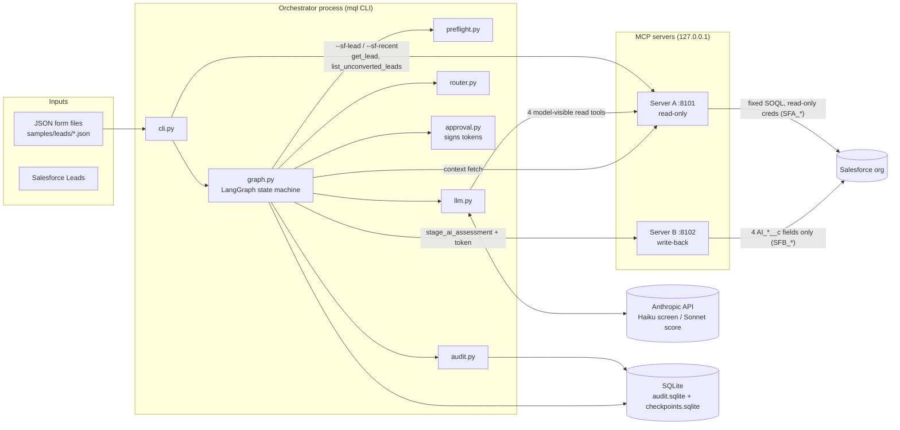
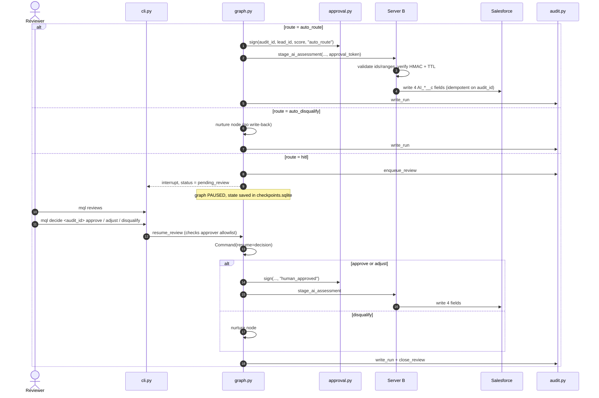
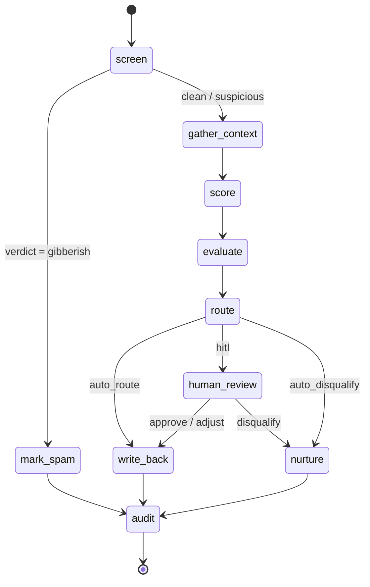
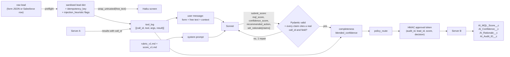

# Architecture and Flow

How the MQL agent fits together: which code depends on which, how a lead moves through the system, and in what order things run.

> Diagrams use [Mermaid](https://mermaid.js.org/), which GitHub wikis render natively.

**Design rule in one line:** Claude scores; deterministic code decides; Salesforce is reached only through two scoped MCP servers. Claude is never given a write tool.

---

## 1. System at a glance

Three processes run at once: the **orchestrator** (the `mql` CLI plus the LangGraph pipeline) and the two **MCP servers**.



**Trust boundaries**

| Component | Can read Salesforce | Can write Salesforce | Sees untrusted lead text |
| --- | --- | --- | --- |
| Claude (Haiku / Sonnet) | Only via 4 Server A tools, called by orchestrator code on its behalf | **No** | Yes, wrapped in `<lead_text>` after sanitising |
| Server A | Yes (read-only creds) | No | No |
| Server B | No | Only 4 allowlisted fields, only with a valid signed token | No |
| Router / `approval.py` | n/a | Holds the signing key | No |

---

## 2. Module dependency map

Arrows read "imports / depends on". Built from the actual `import` statements.

```mermaid
flowchart TD
    cli[cli.py] --> audit[audit.py]
    cli --> settings[settings.py]
    cli -. "lazy import" .-> graph[graph.py]

    graph --> approval[approval.py]
    graph --> audit
    graph --> llm[llm.py]
    graph --> mcp_tools[mcp_tools.py]
    graph --> models[models.py]
    graph --> preflight[preflight.py]
    graph --> router[router.py]
    graph --> settings

    llm --> mcp_tools
    llm --> models
    llm --> preflight
    llm --> router
    llm --> settings
    llm -. "provider=fake" .-> fake_llm[fake_llm.py]

    router --> models
    settings --> yaml[(config/policy.yaml)]
    settings --> files[(prompts/ + config/rubric_v1.md)]

    server_b[servers/server_b.py] --> approval
    server_b --> sf_repo[servers/sf_repo.py]
    server_a[servers/server_a.py] --> sf_repo
    sf_repo --> sfdc[(Salesforce via simple-salesforce<br/>or fake_org.json)]
    server_a --> firmo[(firmographics_demo.json)]

    mcp_tools -. "HTTP / MCP at runtime<br/>(no Python import)" .-> server_a
    mcp_tools -. "HTTP / MCP at runtime<br/>(no Python import)" .-> server_b
```

Things worth knowing:

- **`graph.py` is the hub.** Everything in `mqlagent/` is wired together there.
- **`models.py` and `settings.py` are the leaves** that most others lean on.
- **`approval.py` is the only code shared across the trust boundary.** The router signs with it; Server B imports `verify` from it. Claude never touches it.
- **The orchestrator and servers never import each other's I/O code.** They talk over MCP (streamable HTTP), which is why `mcp_tools.py` has a dotted line rather than a solid one.
- **`sf_repo.py` is the only place Salesforce queries exist.** It has a `SalesforceRepo` (real) and a `FakeRepo` (backed by `servers/fake_org.json`, enabled by `MQL_FAKE_SALESFORCE=1`).

---

## 3. Execution sequence

### 3a. Startup order

1. Start Server A: `python -m servers.server_a` (port 8101).
2. Start Server B: `python -m servers.server_b` (port 8102).
3. Run the CLI: `mql run ...`. The CLI calls `make_runtime()`, which loads settings and `policy.yaml`, creates the Anthropic client (or the fake one), opens the audit DB, and compiles the graph with a SQLite checkpointer.

### 3b. One lead, end to end

```mermaid
sequenceDiagram
    autonumber
    actor U as User
    participant CLI as cli.py
    participant G as graph.py
    participant PF as preflight.py
    participant AU as audit.py
    participant H as Claude Haiku
    participant A as Server A
    participant S as Claude Sonnet
    participant R as router.py
    participant B as Server B
    participant SF as Salesforce

    U->>CLI: mql run --sf-lead / --file
    opt Salesforce source
        CLI->>A: get_lead / list_unconverted_leads
        A->>SF: fixed SOQL (read-only)
        A-->>CLI: lead(s) shaped like form submissions
    end
    CLI->>G: process_lead(raw)
    G->>PF: run_preflight(raw)
    Note over PF: email format, honeypot, disposable domain,<br/>consent, sanitise text, injection heuristics,<br/>idempotency key
    alt rejected
        PF-->>G: rejected(reason)
        G->>AU: record_reject (hashed email)
        G-->>U: rejected_preflight
    end
    G->>AU: already_processed(key)?
    alt duplicate
        G-->>U: duplicate (no-op)
    end

    rect rgb(235, 245, 255)
    Note over G,SF: LangGraph run (thread_id = idempotency key)
    G->>H: screen_free_text (forced report_screen)
    H-->>G: clean / suspicious / gibberish
    alt gibberish
        G->>AU: write_run (route=spam)
    else continue
        G->>A: lookup_crm_account, check_open_opportunities, enrich_firmographics
        A-->>G: tool_log (each with a call_id)
        G->>S: score_lead (rubric + context + 4 read tools)
        loop up to max_tool_calls (6)
            S->>A: optional extra read tool calls
            A-->>S: results
        end
        S-->>G: submit_score (validated; citations checked)
        G->>R: completeness + policy_route
        R-->>G: auto_route | hitl | auto_disqualify
    end
    end
```

### 3c. After routing: three outcomes



---

## 4. The LangGraph state machine

Defined in `build_graph()` in [`mqlagent/graph.py`](../mqlagent/graph.py). State is the `LeadState` Pydantic model in [`models.py`](../mqlagent/models.py).



| Node | What it does | Deterministic? |
| --- | --- | --- |
| `screen` | Haiku classifies free text (`clean` / `suspicious` / `gibberish`). On any error it fails closed to `suspicious`. | No (LLM) |
| `mark_spam` | Sets route `spam`, action `discarded`. | Yes |
| `gather_context` | Calls Server A for account, open opportunities and firmographics. Fixed sequence, not the model's choice, because the router depends on it. | Yes |
| `score` | Sonnet tool loop over Server A, ending in a forced `submit_score`. One repair attempt if validation or citations fail. | No (LLM) |
| `evaluate` | Computes data completeness, blended confidence (`min(model confidence, completeness)`), and open-opportunity conflict. | Yes |
| `route` | Applies the policy decision table. | Yes |
| `human_review` | Enqueues the review, then `interrupt()` pauses the graph until `mql decide`. | Yes |
| `write_back` | Signs an approval token and calls Server B. Skipped for form leads with no Salesforce Lead Id. | Yes |
| `nurture` | Records the outcome, no Salesforce write. | Yes |
| `audit` | Appends the full run to the audit DB. | Yes |

---

## 5. Policy decision table

`policy_route()` in [`router.py`](../mqlagent/router.py). **First match wins.** Thresholds live in [`config/policy.yaml`](../config/policy.yaml).

| # | Condition | Route | Reason |
| --- | --- | --- | --- |
| 1 | Model output invalid or missing | `hitl` | `invalid_model_output` |
| 2 | Screen verdict is `suspicious` | `hitl` | `screen_flag` |
| 3 | Injection heuristic matched in free text | `hitl` | `injection_heuristic` |
| 4 | Domain is in `strategic_domains` (e.g. `uos.com`) | `hitl` | `strategic_account` |
| 5 | Open opportunity exists on the account | `hitl` | `open_opp_conflict` |
| 6 | score ≥ 80 **and** blended confidence ≥ 0.85 | `auto_route` | `high_fit` |
| 7 | score ≤ 49 **and** blended confidence ≥ 0.85 | `auto_disqualify` | `clear_non_icp` |
| 8 | Anything else | `hitl` | `borderline` |

---

## 6. Flow of information: what carries what



Key ideas:

- **`call_id` is the thread that ties claims to evidence.** Every Server A response gets one; the form itself is `"form"`. The scorer must cite `call_id` + exact field for each rationale claim, and `check_citations()` rejects claims that point at nothing.
- **`LeadState.tool_log` and `usage` use `operator.add` reducers**, so each node appends rather than overwrites.
- **The idempotency key is also the LangGraph `thread_id`.** That is how a paused review is found and resumed, and how re-runs become no-ops. `--rerun-tag` changes the salt to force a re-score.

---

## 7. Security layers (in the order a lead meets them)

| Layer | Where | Defence |
| --- | --- | --- |
| 1. Pre-flight | `preflight.py` | Email validation, honeypot, disposable domains, consent gate, Unicode normalisation (NFKC), zero-width/bidi stripping, angle-bracket escaping, length cap, injection regexes |
| 2. Screen | `llm.py` | Cheap Haiku pass; fails closed to human review |
| 3. Tool scoping | `mcp_tools.py` | Model sees only 4 read tools; `get_lead` / `list_unconverted_leads` are ingest-only; no write tool exists for the model |
| 4. Router | `router.py` | Citation check, completeness cap, strategic-account and open-opp overrides. No LLM |
| 5. Approval token | `approval.py` + `server_b.py` | HMAC over (audit_id, lead_id, score, decision), 15-minute TTL, only `auto_route` / `human_approved` writable |
| 6. Server B limits | `server_b.py` | ID regex checks, range checks, field allowlist, idempotent on `audit_id` |
| 7. Salesforce | `salesforce/` | Permission sets `MQL_Agent_Read` / `MQL_Agent_Write`; fields staged, not acted on |
| 8. Audit | `audit.py` | Append-only tables (SQL triggers block UPDATE and DELETE); every input, tool call, score and decision recorded |

---

## 8. Data stores

| Store | Location | Contents | Mutable? |
| --- | --- | --- | --- |
| Audit DB | `data/audit.sqlite` | `ai_audit_run`, `ai_audit_tool_call`, `preflight_rejects` | **Append-only** (triggers) |
| Review queue | same DB, `review_queue` | Pending and decided human reviews | Yes (operational) |
| Checkpoints | `data/checkpoints.sqlite` | LangGraph state for paused runs | Yes |
| Policy | `config/policy.yaml` | Thresholds, strategic domains, consent and spam rules | Versioned in git |
| Rubric and prompts | `config/rubric_v1.md`, `prompts/*_v1.md` | What the models are told | Versioned in git |

The policy, prompt and rubric versions are stamped on every audit row, so any past decision can be traced to the exact rules in force.

---

## 9. Repository map

| Path | Role | Depends on |
| --- | --- | --- |
| `mqlagent/cli.py` | `mql` entry point: `run`, `reviews`, `decide`, `audit`, `show` | `audit`, `settings`, `graph` (lazy) |
| `mqlagent/graph.py` | State machine, pause/resume, write-back | all other `mqlagent` modules |
| `mqlagent/preflight.py` | Deterministic input gates and sanitising | stdlib only |
| `mqlagent/llm.py` | Haiku screen, Sonnet tool loop, client factory | `mcp_tools`, `models`, `preflight`, `router`, `settings` |
| `mqlagent/fake_llm.py` | Scripted model for wiring checks and tests | none |
| `mqlagent/router.py` | Citation check, completeness, decision table | `models` |
| `mqlagent/mcp_tools.py` | MCP client sessions and call logging | `mcp`, `httpx` |
| `mqlagent/approval.py` | HMAC sign / verify | stdlib only |
| `mqlagent/audit.py` | Append-only audit and review queue | stdlib only |
| `mqlagent/models.py` | Pydantic contracts (`LeadState`, `ScoreResult`, ...) | `pydantic` |
| `mqlagent/settings.py` | Env and YAML config loading | `yaml`, `dotenv` |
| `servers/server_a.py` | Read-only MCP server, 6 tools | `sf_repo` |
| `servers/server_b.py` | Write-back MCP server, 1 tool | `approval`, `sf_repo` |
| `servers/sf_repo.py` | Real and fake Salesforce data access | `simple_salesforce`, `sf` CLI |
| `servers/fake_org.json`, `firmographics_demo.json` | Demo data | none |
| `salesforce/` | Field and permission-set metadata to deploy | n/a |
| `samples/leads/` | Test leads: hot, strategic, injection, honeypot, no consent, etc. | n/a |
| `tests/` | Unit tests and end-to-end tests; `conftest.py` starts both servers against the fake org | everything |

---

## 10. Where to start reading

1. [`models.py`](../mqlagent/models.py): the data shapes everything passes around.
2. [`graph.py`](../mqlagent/graph.py): `build_graph()` is the whole pipeline on one page.
3. [`preflight.py`](../mqlagent/preflight.py) then [`router.py`](../mqlagent/router.py): the deterministic rules.
4. [`llm.py`](../mqlagent/llm.py): the scoring loop (`score_lead`).
5. [`server_a.py`](../servers/server_a.py), [`server_b.py`](../servers/server_b.py), [`approval.py`](../mqlagent/approval.py): the Salesforce boundary.
6. [`tests/test_e2e.py`](../tests/test_e2e.py): working examples of every path above.
