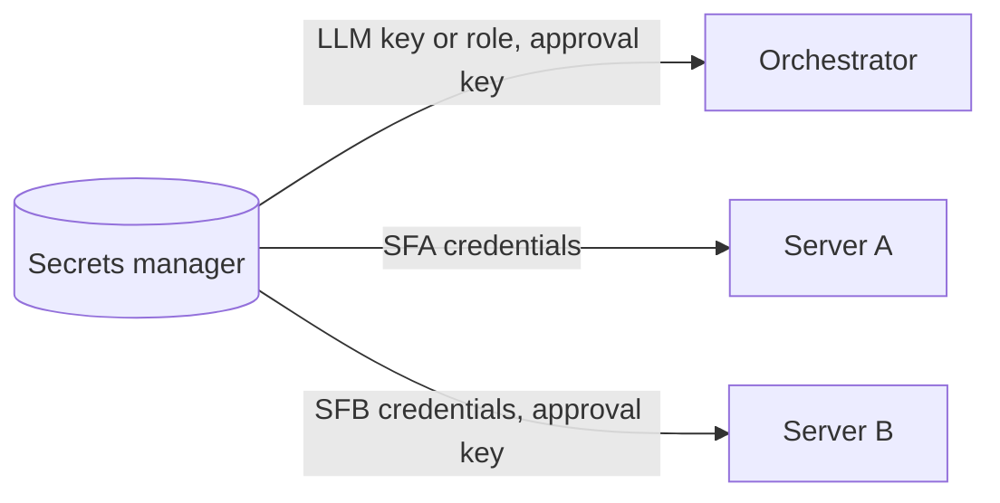

# Production Readiness

What it takes to move the MQL agent from a laptop prototype to a production deployment. See [Architecture and Flow](Architecture-and-Flow.md) for how the pieces connect.

> Status: this page is a checklist derived from the code and the README's "Not in this prototype" list. Nothing here has been deployed or load tested.

---

## 1. Fix first: security gaps in the prototype

| Gap | Where | What to do |
| --- | --- | --- |
| Servers A and B have no authentication. They bind to `127.0.0.1` and rely on that. The client can send a Bearer token (`MQL_READ_SERVER_TOKEN`, `MQL_WRITE_SERVER_TOKEN`), but the servers do not check it. | `servers/server_a.py`, `servers/server_b.py` | Verify a token or use mTLS on the servers. Put them on a private network with TLS. |
| Approver identity is self-asserted. `mql decide ... --as jerry` only checks the name against `MQL_APPROVERS`. | `mqlagent/cli.py`, `resume_review` in `mqlagent/graph.py` | Take approver identity from SSO or Slack, not a command-line flag. |
| Fake providers can be switched on by environment variable: `MQL_FAKE_SALESFORCE=1` and `MQL_LLM_PROVIDER=fake`. | `servers/sf_repo.py`, `mqlagent/llm.py` | Refuse to start in production if either is set. |
| Both servers log in as the same Salesforce user through the `sf` CLI alias. | `.env.example`, `servers/sf_repo.py` | Use two integration users, each with only `MQL_Agent_Read` or `MQL_Agent_Write`. |

---

## 2. Infrastructure

| Area | Prototype | Production |
| --- | --- | --- |
| Storage | SQLite files in `data/` | PostgreSQL for audit, review queue and LangGraph checkpoints (`langgraph-checkpoint-postgres`). Recreate the append-only guarantee, for example by revoking `UPDATE` and `DELETE` from the app role. Add backups and retention. |
| Ingestion | CLI only (`mql run`) | Webhook receiver or Salesforce event, a queue, retries, rate limiting |
| Human review | CLI (`mql reviews`, `mql decide`) | Slack cards or a small UI, plus an SLA sweeper for leads left pending |
| Packaging | `pip install -e .` | Containers for orchestrator, Server A and Server B, with a lockfile (the project uses version ranges today). Run Server B separately because it alone holds write credentials. |
| LLM access | Direct API, Bedrock option untested | Timeouts, retries, rate-limit handling, cost alerts. Test whichever provider you choose. |
| Observability | `print()` in the servers | Structured logs, metrics (route mix, review backlog, token cost, tool latency), alerts on Server B rejections |

---

## 3. Settings and secrets

| Setting | Notes |
| --- | --- |
| `ANTHROPIC_API_KEY` (or cloud IAM role) | Orchestrator only |
| `MQL_APPROVAL_KEY` | Shared only by the orchestrator and Server B. Never give it to Server A. |
| `SFA_*` | Server A only. Read-only Salesforce credentials. |
| `SFB_*` | Server B only. Write credentials limited to the four AI fields. |
| `MQL_READ_SERVER_TOKEN`, `MQL_WRITE_SERVER_TOKEN` | Caller and matching server, once the servers verify them |
| `MQL_SCREEN_MODEL`, `MQL_SCORING_MODEL` | Pin explicitly and change through a tested rollout |
| `config/policy.yaml` | Needs Sales and RevOps sign-off. Legal must confirm `crm_leads_assume_basis`. Replace the sample strategic domain. |
| `servers/firmographics_demo.json` | Synthetic. Replace with a real enrichment source. |

`mqlagent/settings.py` reads everything with `os.environ`, and `.env` is only a local fallback. In production there is no `.env` file. The platform sets the same variable names from a secrets manager.

### Who may read which secret



Each service runs under its own identity and can read only its own secrets. The scoring model never receives any of them.

### General practices

- Separate keys per environment (dev, staging, prod), and ideally per service.
- Rotate on a schedule: create the new key, deploy it, then revoke the old one. For `MQL_APPROVAL_KEY`, update the orchestrator and Server B together. The 15-minute token lifetime keeps any overlap short.
- No secrets in code, container images, CI logs or chat. Turn on secret scanning.
- Log every secret read and alert on unusual access or an API spend spike.
- Developers do not get standing read access to production secrets.

---

## 4. Azure

### Components

| Concern | Azure service |
| --- | --- |
| Secret storage | Azure Key Vault (use the Premium tier if you need HSM-backed keys) |
| Workload identity | Managed Identity, or Workload Identity on AKS |
| Access control | Azure RBAC with the *Key Vault Secrets User* role, scoped to one secret or one vault per service |
| Database | Azure Database for PostgreSQL Flexible Server, ideally with Entra ID authentication |
| Monitoring | Key Vault diagnostic logs to Log Analytics, plus Defender for Key Vault or alerts |

### Getting secrets into the process

| Hosting | Mechanism |
| --- | --- |
| Azure Container Apps | Secrets as Key Vault references using the app's managed identity, exposed as environment variables |
| App Service or Functions | Key Vault references in app settings |
| AKS | Workload Identity plus the Secrets Store CSI Driver (Azure Key Vault provider) |
| Virtual machines | Managed identity plus a startup script or agent |

No application code change is needed for any of these.

### Recommended layout

- Three container apps or pods (orchestrator, Server A, Server B), each with its own managed identity.
- One Key Vault per environment, with soft-delete and purge protection on and public network access disabled behind a private endpoint.
- Servers A and B on internal-only ingress or a VNet.
- For Salesforce, use JWT bearer authentication with the signing certificate stored in Key Vault, instead of a stored password.
- Rotation: set expiry dates and subscribe to Event Grid near-expiry events. Third-party secrets such as an Anthropic key need a script, for example an Azure Function triggered by that event.

### Claude on Azure

The repo supports `anthropic` (direct API) and `bedrock`. Anthropic models have also been offered through Microsoft Foundry, where authentication can use Entra ID through a managed identity instead of a stored key. **Verify current availability, regions and model names in Microsoft's documentation before relying on this.**

Using it would need a new branch in `make_client()` in `mqlagent/llm.py`. The sketch below is **unverified**: the client class name and arguments are from memory and must be checked against the current Anthropic SDK documentation. Model names in Foundry are usually deployment names, so `MQL_SCREEN_MODEL` and `MQL_SCORING_MODEL` would hold those.

```python
# Sketch only. Confirm the class name and parameters in the current SDK docs first.
if settings.llm_provider == "foundry":
    from azure.identity import DefaultAzureCredential, get_bearer_token_provider
    token_provider = get_bearer_token_provider(
        DefaultAzureCredential(), "https://cognitiveservices.azure.com/.default")
    return anthropic.AnthropicFoundry(
        azure_ad_token_provider=token_provider,
        base_url=settings.foundry_endpoint,   # new setting, from env
    )
```

If your Azure security team requires all model traffic to stay inside your tenant, that decides it. Otherwise the direct API with the key in Key Vault is simpler.

---

## 5. Salesforce side

- Deploy `salesforce/` (four Lead fields and two permission sets) through your normal release pipeline, then add the fields to page layouts.
- Optionally build the record-triggered Flow described in the README so RevOps owns routing after the staging fields are written.
- Check API call limits against expected lead volume.

---

## 6. Quality and release process

- Run `pytest` in CI on every change.
- Add the golden-dataset regression gate and the nightly outcome join from the README's roadmap.
- Treat any change to the rubric, prompts or policy as a versioned release. The versions are already stamped on every audit row.
- Decide retention and access rules for audit data. Rows hold sanitised lead input, which can contain personal data.

---

## 7. Why Python is a good fit for the deterministic logic

- Determinism comes from the design, not the language. `router.py`, `preflight.py` and `approval.py` are plain functions with no model calls, and the thresholds live in YAML.
- The logic is small and not CPU-bound. Time goes to model calls and Salesforce round trips.
- The Anthropic SDK, LangGraph, the MCP SDK, Pydantic and simple-salesforce are all first-class in Python.
- TypeScript is a reasonable alternative for a team that already works in it. Java or Go would mean more glue code and less mature agent tooling.
- To close Python's main weakness (dynamic typing), run `mypy --strict` on the three deterministic modules and add property-based tests for the decision table and the token verifier.
